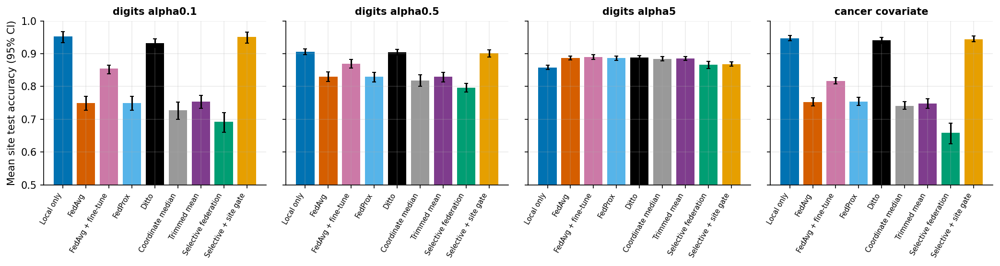

# When Not to Learn

### Selective collaboration for more reliable federated learning

**Research question:** *When should a participant's update be included in collaborative training—and when should a model stay local, personalise, or abstain?*

`when_not_to_learn` is an open research prototype for studying selective participation in federated learning under client heterogeneity and distribution shift. It compares local-only training, conventional Federated Averaging (FedAvg), and a transparent validation-guided selection baseline on synthetic multi-site data.

> **Research status:** early experimental baseline (v0.4). The code is intended to make assumptions testable—not to claim novelty, guarantee improvements, or provide production-grade privacy. Results are on synthetic data and on public datasets with synthetic partitions.

<p align="center">
  
  <a href="https://github.com/abhinavannareddy/when_not_to_learn/actions/workflows/tests.yml"></a>
  
  
  
  
</p>

## Explore the interactive Decision Observatory

**[Open the interactive demo](demo/index.html)** — change the shift round, severity, client heterogeneity, and decision policy; inspect per-client decisions and a round-by-round audit trace. It is a self-contained HTML demo and runs locally in a browser.

> **Important:** the current dashboard is a conceptual, synthetic simulator. Its displayed metrics are illustrative and are **not** generated by the Python experiment runner. The next engineering milestone is to connect the UI to real, logged experiment outputs.

### System concept


## Headline findings (20 seeds, with confidence intervals)

The benchmark makes a third of the sites **drift mid-training**, compares **nine strategies**, and then repeats the question on **two real public datasets** with non-IID partitions. Everything is reproducible with one command each (see [Reproduce](#reproduce-the-results)); full tables are in [`docs/RESULTS.md`](docs/RESULTS.md) and a draft write-up is in [`docs/PAPER.md`](docs/PAPER.md).


| Method (synthetic drift benchmark) | Final mean accuracy (95% CI) | Final worst-site accuracy |
|---|---|---|
| Local only | **0.929** (0.919–0.938) | **0.876** |
| Selective + site gate | **0.929** (0.919–0.938) | **0.875** |
| Ditto | 0.914 (0.903–0.924) | 0.861 |
| FedAvg + fine-tune | 0.886 (0.870–0.901) | 0.798 |
| FedAvg / FedProx | 0.843 (0.822–0.863) | 0.675 / 0.678 |
| Trimmed mean / Coordinate median | 0.839 / 0.834 | 0.645 / 0.616 |
| Selective federation | 0.825 (0.800–0.849) | 0.704 |

What the evidence does — and does not — support:

1. **When sites differ, collaboration is usually the wrong call.** Local or personalised training beat every global-model method, and a per-site gate (use the federated model only if it lowers *your own* validation loss) abstained in ~96 % of decisions under strong heterogeneity. This is the "when *not* to learn" result.
2. **It replicates on real data.** On digits with near-IID sites (Dirichlet α = 5) federating *helps* (FedAvg +2.8 pp over local, 95% CI +2.1 to +3.6; the gate federates 54 % of the time). With strong label skew (α = 0.1) FedAvg is **20 pp worse** than local, while Ditto stays within 2 pp.
3. **Collaboration helps in a narrow regime** — near-identical sites with little local data (about +1 to +3 pp) — and hurts increasingly as heterogeneity grows (up to −14 pp).
4. **The validation-guided selection rule is not an accuracy win** (−1.8 pp vs FedAvg, CI −2.6 to −0.9), but **it is a robustness win**: its worst-site advantage over FedAvg grows with drift severity (up to +12 pp) and federation size (+14 pp at 12 sites). It is insensitive to its tolerance and to validation-set size (5 samples per site was enough).
5. **Personalisation is a stronger baseline than selection.** Ditto beats FedAvg by +7.1 pp mean / +18.6 pp worst-site; FedProx (μ = 0.1) and trimmed mean add nothing over FedAvg here.

<p align="center">
  
  
</p>

*Left: accuracy gain over local-only (pp) across heterogeneity × local data size. Right: methods on real digits / breast-cancer partitions.*

These conclusions are specific to small linear models and oracle-style validation; treat them as hypotheses to test further, not as findings about production federations.

## Why this problem matters

Federated learning lets organisations train collaboratively without pooling their raw training records. But their data can differ: hospitals serve different populations, telecom operators cover different geographies, and factories run different equipment. A shared update may help one participant while hurting another. Those relationships can also change over time.

This project asks whether a federation can use evidence about local and worst-site performance to decide when collaboration is useful, instead of assuming every update should always be aggregated.

## What is implemented today

- **Synthetic non-IID clients** representing independent sites.
- **Local-only baseline**: each site trains without cross-site updates.
- **FedAvg baseline**: all clients contribute in each communication round.
- **Selective-federation baseline**: candidate updates are screened using simulated validation metrics across all sites, with mean- and worst-site-loss guardrails.
- **Shifted held-out test distributions** to probe generalisation beyond each site's training distribution.
- **Evaluation metrics**: mean accuracy, worst-site accuracy, mean log-loss, and personalised mean accuracy.
- **Reproducible runs** using explicit random seeds; optional multi-seed aggregation reports means and standard deviations.
- **Artifacts**: JSON summary, per-seed CSV, and an optional participation plot.
- **Temporal drift benchmark** (`drift.py`): a subset of sites changes distribution at a chosen round; every method is scored every round, with drop-at-drift and recovery metrics.
- **Nine strategies compared**: local-only, FedAvg, FedAvg + local fine-tuning, FedProx, Ditto, coordinate median, trimmed mean, selective federation, and selective federation with a per-site abstention gate.
- **Three drift schedules** (abrupt, gradual, recurring) and configurable severity, heterogeneity, federation size, selection tolerance, and validation-set size.
- **Real-data experiments** (`realdata.py`): scikit-learn digits and breast-cancer datasets, partitioned with label skew (Dirichlet α) and covariate skew.
- **Paired statistics** (`stats.py`): bootstrap confidence intervals, sign-flip permutation p-values, win rates, and paired effect sizes across seeds.
- **Ablations**: heterogeneity × local-data-size maps (with and without drift), drift severity, selection tolerance, number of sites, and validation size.
- **Measured-results panel in the demo**, generated from the committed result files by `scripts/build_demo_data.py`.
- **Automated tests, linting (ruff), and CI** on Python 3.10–3.13.

## Quick start

### Windows PowerShell

```powershell
py -m venv .venv
.\.venv\Scripts\Activate.ps1
python -m pip install --upgrade pip
python -m pip install -e ".[experiments,test]"
python -m pytest
```

Run one reproducible experiment:

```powershell
python -m when_not_to_learn.experiment --seed 7 --rounds 25 --out results
```

Run a small multi-seed sweep (recommended over interpreting one run):

```powershell
python -m when_not_to_learn.experiment --seeds 1,2,3,4,5,6,7,8,9,10 --rounds 25 --out results_10_seeds
```

### Reproduce the results

```powershell
python -m when_not_to_learn.benchmark --seeds 20 --sweep-seeds 10 --out results/benchmark   # ~25 min
python -m when_not_to_learn.realdata --seeds 20 --out results/realdata                      # ~3 min
```

The first writes `summary.json`, per-seed `scalars.csv`, ablation grids, and all figures; use `--no-sweeps` for a ~1-minute run. The second needs scikit-learn (`pip install -e ".[realdata]"`). They are installed as `wnl-benchmark` and `wnl-realdata`.

If PowerShell blocks virtual-environment activation, use `\.venv\Scripts\python.exe` in place of `python` in the commands above.

### macOS / Linux

```bash
python3 -m venv .venv
source .venv/bin/activate
python -m pip install --upgrade pip
python -m pip install -e '.[experiments,test]'
python -m pytest
python -m when_not_to_learn.experiment --seeds 1,2,3,4,5 --rounds 25 --out results
```

## Outputs

| File | Contents |
|---|---|
| `summary.json` | Configuration, individual run outputs, and aggregate mean / standard deviation across seeds. |
| `metrics.csv` | One row per seed and method for analysis in Python, R, Excel, or a notebook. |
| `participation.png` | Per-round participation diagnostic for the first seed in the run. |

Generated `results/` directories are ignored by Git by default. Commit result artifacts only when the experiment is reproducible and you want to preserve them as a research record.

## Research design and limitations

This is a deliberately small baseline, not a state-of-the-art benchmark. Please read [`docs/RESEARCH_PLAN.md`](docs/RESEARCH_PLAN.md) before interpreting the outputs.

1. **Small, public datasets and synthetic partitions.** The current results cannot establish effectiveness in hospitals, telecom, or industrial settings.
2. **The selection rule is not claimed as novel.** Validation-guided selection is a starting point for comparison and critique.
3. **Oracle-style validation.** Candidate updates are evaluated against every simulated site's validation set. This central evaluator has access to site-level validation data/metrics; it is not a deployable privacy-preserving protocol. (A validation-size ablation shows the rule still works with 5 samples per site, but that does not make it private.)
4. **No formal privacy guarantee.** There is no differential privacy, secure aggregation, cryptographic protection, or formal leakage analysis in this version. Federated learning alone does not guarantee privacy.
5. **Drift is simulated.** Abrupt, gradual, and recurring schedules are supported, but they come from one parametric family with a fixed subset of drifted sites; label-only drift is not covered. The original `experiment.py` runner still uses a held-out shifted test set as a proxy. The real-data experiments have no temporal drift.
6. **Guardrails are not guarantees.** Individually screened candidates can interact badly when aggregated, and the final aggregate is not guaranteed to satisfy the same thresholds.
7. **Small, linear models.** Logistic regression on six features is a clean testbed, not a stand-in for deep models.
8. **No result is guaranteed to win.** If selective federation underperforms, report it and investigate why. Do not select only favourable seeds or metrics.

## Roadmap

- [x] Establish local-only and FedAvg baselines.
- [x] Implement an explicit selective-update baseline.
- [x] Add repeatable seed-based evaluation and machine-readable outputs.
- [x] Add automated tests and continuous integration.
- [x] Add true temporal drift during training and recovery-time measurements.
- [x] Add a personalised baseline (fine-tuned FedAvg) and a robust-aggregation baseline (coordinate median).
- [x] Add confidence intervals and paired statistical comparisons across seeds.
- [x] Add ablations for client heterogeneity, local data size, and drift severity.
- [x] Add ablations for selection tolerance, number of clients, and validation-set size.
- [x] Add FedProx / Ditto / trimmed-mean baselines (fixed defaults; **not yet tuned**).
- [x] Evaluate on public datasets (digits, breast cancer) with non-IID partitions.
- [x] Add gradual and recurring drift schedules.
- [x] Connect the demo to real logged results.
- [ ] Tune baselines with matched budgets (μ, trim fraction, tolerance).
- [ ] Replace oracle validation with a secure-aggregated or differentially private selection signal.
- [ ] Investigate privacy leakage of the exchanged metrics.
- [ ] Evaluate deep models on a realistic multi-site benchmark (e.g. FEMNIST or multi-hospital data).
- [ ] Peer review and a literature check of `docs/PAPER.md` before any submission.

## Repository map

```text
when_not_to_learn/
├── .github/workflows/tests.yml    # Continuous integration
├── assets/decision-architecture.svg # Conceptual system diagram
├── demo/index.html                # Interactive Decision Observatory (synthetic)
├── docs/RESEARCH_PLAN.md          # Research questions, hypotheses, milestones
├── docs/results/                  # Committed benchmark data (JSON/CSV)
├── src/when_not_to_learn/
│   ├── core.py                    # Synthetic clients, training, baselines, metrics
│   ├── experiment.py              # Original single/multi-seed CLI
│   ├── drift.py                   # Drift scenarios and nine strategies
│   ├── realdata.py                # Real-dataset partitions and experiments
│   ├── stats.py                   # Bootstrap CIs and paired comparisons
│   └── benchmark.py               # One-command benchmark, ablations, figures
├── assets/results/                # Figures generated by the benchmark
├── docs/RESULTS.md                # Full results, tables, and interpretation
├── docs/PAPER.md                  # Draft technical report with related work
├── docs/METHODOLOGY.md            # Scenario, metrics, and statistics definitions
├── scripts/build_demo_data.py     # Embeds measured results into the demo
├── CHANGELOG.md
├── tests/                         # Unit and reproducibility tests
├── CITATION.cff                   # Citation metadata
├── LICENSE
├── pyproject.toml
└── README.md
```

## How to contribute or challenge the idea

Useful contributions include a reproducible counterexample, a stronger baseline, a drift scenario, a metric critique, or a well-motivated change to the selection rule. Please include the command, seed(s), configuration, and output needed to reproduce a reported result. See the research plan before opening a feature request.

## Citation

If you reference this prototype, use the metadata in [`CITATION.cff`](CITATION.cff). The repository is an evolving research artifact, not a peer-reviewed publication.

## License

Released under the MIT License; see [`LICENSE`](LICENSE).
