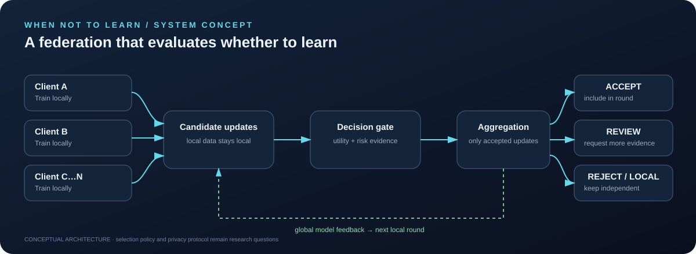
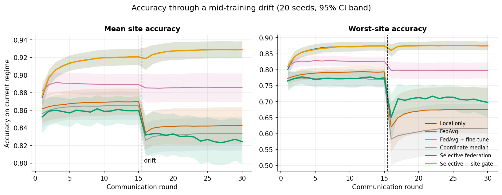
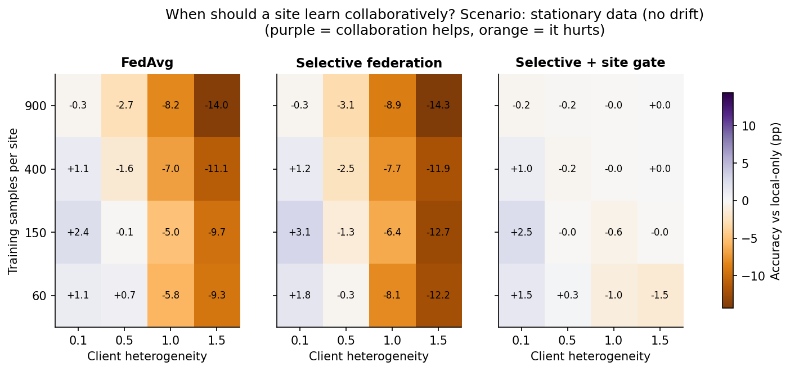
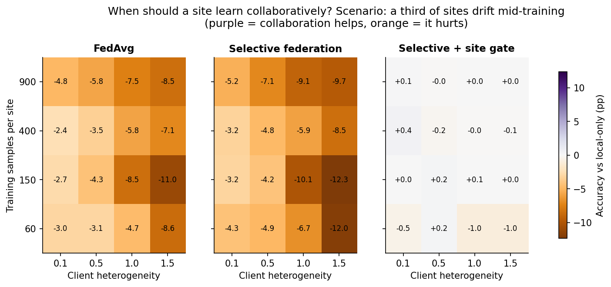

# When Not to Learn

### Selective collaboration for more reliable federated learning

**Research question:** *When should a participant's update be included in collaborative training—and when should a model stay local, personalise, or abstain?*

`when_not_to_learn` is an open research prototype for studying selective participation in federated learning under client heterogeneity and distribution shift. It compares local-only training, conventional Federated Averaging (FedAvg), and a transparent validation-guided selection baseline on synthetic multi-site data.

> **Research status:** early experimental baseline (v0.3). The code is intended to make assumptions testable—not to claim novelty, guarantee improvements, or provide production-grade privacy. All results are on synthetic data.

<p align="center">
  
  <a href="https://github.com/abhinavannareddy/when_not_to_learn/actions/workflows/tests.yml"></a>
  
  
  
  
</p>

## Explore the interactive Decision Observatory

**[Open the interactive demo](demo/index.html)** — change the shift round, severity, client heterogeneity, and decision policy; inspect per-client decisions and a round-by-round audit trace. It is a self-contained HTML demo and runs locally in a browser.

> **Important:** the current dashboard is a conceptual, synthetic simulator. Its displayed metrics are illustrative and are **not** generated by the Python experiment runner. The next engineering milestone is to connect the UI to real, logged experiment outputs.

### System concept



## Headline findings (synthetic, 20 seeds)

The v0.3 benchmark makes a third of the sites **drift mid-training** (covariate *and* concept shift at round 15) and compares six strategies. Every number below is reproducible with one command (see [Reproduce](#reproduce-the-results)) and is documented in [`docs/RESULTS.md`](docs/RESULTS.md).



| Method | Final mean accuracy (95% CI) | Final worst-site accuracy |
|---|---|---|
| Local only | **0.929** (0.919–0.938) | **0.876** |
| Selective + site gate | **0.929** (0.919–0.938) | **0.875** |
| FedAvg + fine-tune | 0.886 (0.870–0.901) | 0.798 |
| FedAvg | 0.843 (0.822–0.863) | 0.675 |
| Coordinate median | 0.834 (0.815–0.852) | 0.616 |
| Selective federation | 0.825 (0.800–0.849) | 0.704 |

What the evidence does — and does not — support:

1. **Under strong heterogeneity, collaboration was usually the wrong call.** Local training beat every shared model; the per-site gate (each site keeps the federated model only if it lowers its own validation loss) chose the federated model just **3.5 %** of the time and so matched local-only. This is the "when *not* to learn" result.
2. **Collaboration helps in a narrow regime** — near-identical sites with little local data (about **+2 pp**) — and hurts increasingly as heterogeneity grows (up to **−14 pp**). See the maps below.
3. **The validation-guided selection rule is *not* a clear win.** It lowers mean accuracy versus FedAvg (−1.8 pp, 95% CI −2.6 to −0.9) and its worst-site gain versus FedAvg is not distinguishable from zero (+2.9 pp, CI −0.4 to +7.0). It does clearly beat coordinate-median aggregation on worst-site accuracy (+8.8 pp, CI +4.1 to +14.1).
4. **Personalisation is a stronger baseline than selection.** Fine-tuning FedAvg locally gains +4.3 pp mean and +12.3 pp worst-site accuracy over plain FedAvg.

<p align="center">
  
  
</p>

*Accuracy gain over local-only training (percentage points) across client heterogeneity × local data size. Left: no drift. Right: a third of sites drift.*

These conclusions are specific to a logistic-regression simulator with oracle-style validation; they are hypotheses for further testing, not findings about real federations.

## Why this problem matters

Federated learning lets organisations train collaboratively without pooling their raw training records. But their data can differ: hospitals serve different populations, telecom operators cover different geographies, and factories run different equipment. A shared update may help one participant while hurting another. Those relationships can also change over time.

This project asks whether a federation can use evidence about local and worst-site performance to decide when collaboration is useful, instead of assuming every update should always be aggregated.

## What is implemented today

- **Synthetic non-IID clients** representing independent sites.
- **Local-only baseline**: each site trains without cross-site updates.
- **FedAvg baseline**: all clients contribute in each communication round.
- **Selective-federation baseline**: candidate updates are screened using simulated validation metrics across all sites, with mean- and worst-site-loss guardrails.
- **Shifted held-out test distributions** to probe generalisation beyond each site's training distribution.
- **Evaluation metrics**: mean accuracy, worst-site accuracy, mean log-loss, and personalised mean accuracy.
- **Reproducible runs** using explicit random seeds; optional multi-seed aggregation reports means and standard deviations.
- **Artifacts**: JSON summary, per-seed CSV, and an optional participation plot.
- **Temporal drift benchmark** (`drift.py`): a subset of sites changes distribution at a chosen round; every method is scored every round, with drop-at-drift and recovery metrics.
- **Six strategies compared**: local-only, FedAvg, FedAvg + local fine-tuning, coordinate-wise median (robust aggregation), selective federation, and selective federation with a per-site abstention gate.
- **Paired statistics** (`stats.py`): bootstrap confidence intervals, sign-flip permutation p-values, win rates, and paired effect sizes across seeds.
- **Ablations**: heterogeneity × local-data-size maps (with and without drift) and a drift-severity sweep.
- **Automated tests, linting (ruff), and CI** on Python 3.10–3.13.

## Quick start

### Windows PowerShell

```powershell
py -m venv .venv
.\.venv\Scripts\Activate.ps1
python -m pip install --upgrade pip
python -m pip install -e ".[experiments,test]"
python -m pytest
```

Run one reproducible experiment:

```powershell
python -m when_not_to_learn.experiment --seed 7 --rounds 25 --out results
```

Run a small multi-seed sweep (recommended over interpreting one run):

```powershell
python -m when_not_to_learn.experiment --seeds 1,2,3,4,5,6,7,8,9,10 --rounds 25 --out results_10_seeds
```

### Reproduce the results

```powershell
python -m when_not_to_learn.benchmark --seeds 20 --sweep-seeds 8 --out results/benchmark
```

This writes `summary.json`, per-seed `scalars.csv`, ablation grids, and all figures (about 5 minutes on a laptop CPU). Use `--no-sweeps` for a fast run. The same command is installed as `wnl-benchmark`.

If PowerShell blocks virtual-environment activation, use `\.venv\Scripts\python.exe` in place of `python` in the commands above.

### macOS / Linux

```bash
python3 -m venv .venv
source .venv/bin/activate
python -m pip install --upgrade pip
python -m pip install -e '.[experiments,test]'
python -m pytest
python -m when_not_to_learn.experiment --seeds 1,2,3,4,5 --rounds 25 --out results
```

## Outputs

| File | Contents |
|---|---|
| `summary.json` | Configuration, individual run outputs, and aggregate mean / standard deviation across seeds. |
| `metrics.csv` | One row per seed and method for analysis in Python, R, Excel, or a notebook. |
| `participation.png` | Per-round participation diagnostic for the first seed in the run. |

Generated `results/` directories are ignored by Git by default. Commit result artifacts only when the experiment is reproducible and you want to preserve them as a research record.

## Research design and limitations

This is a deliberately small baseline, not a state-of-the-art benchmark. Please read [`docs/RESEARCH_PLAN.md`](docs/RESEARCH_PLAN.md) before interpreting the outputs.

1. **Synthetic data only.** The current results cannot establish effectiveness in hospitals, telecom, or industrial settings.
2. **The selection rule is not claimed as novel.** Validation-guided selection is a starting point for comparison and critique.
3. **Oracle-style validation.** Candidate updates are evaluated against every simulated site's validation set. This central evaluator has access to site-level validation data/metrics; it is not a deployable privacy-preserving protocol.
4. **No formal privacy guarantee.** There is no differential privacy, secure aggregation, cryptographic protection, or formal leakage analysis in this version. Federated learning alone does not guarantee privacy.
5. **Drift is a single abrupt event.** The v0.3 benchmark switches distributions at one round for a fixed subset of sites. Gradual, recurring, and label-only drift are not yet covered, and the original `experiment.py` runner still uses a held-out shifted test set as a proxy.
6. **Guardrails are not guarantees.** Individually screened candidates can interact badly when aggregated, and the final aggregate is not guaranteed to satisfy the same thresholds.
7. **Small, linear models.** Logistic regression on six features is a clean testbed, not a stand-in for deep models.
8. **No result is guaranteed to win.** If selective federation underperforms, report it and investigate why. Do not select only favourable seeds or metrics.

## Roadmap

- [x] Establish local-only and FedAvg baselines.
- [x] Implement an explicit selective-update baseline.
- [x] Add repeatable seed-based evaluation and machine-readable outputs.
- [x] Add automated tests and continuous integration.
- [x] Add true temporal drift during training and recovery-time measurements.
- [x] Add a personalised baseline (fine-tuned FedAvg) and a robust-aggregation baseline (coordinate median).
- [x] Add confidence intervals and paired statistical comparisons across seeds.
- [x] Add ablations for client heterogeneity, local data size, and drift severity.
- [ ] Add ablations for selection tolerance, number of clients, and validation-set size.
- [ ] Add FedProx / Ditto / trimmed-mean baselines with matched tuning budgets.
- [ ] Replace oracle validation with a noisy or secure-aggregated selection signal.
- [ ] Investigate privacy leakage and realistic privacy-preserving evaluation protocols.
- [ ] Evaluate on an appropriate public benchmark before making applied claims.

## Repository map

```text
when_not_to_learn/
├── .github/workflows/tests.yml    # Continuous integration
├── assets/decision-architecture.svg # Conceptual system diagram
├── demo/index.html                # Interactive Decision Observatory (synthetic)
├── docs/RESEARCH_PLAN.md          # Research questions, hypotheses, milestones
├── docs/results/                  # Committed benchmark data (JSON/CSV)
├── src/when_not_to_learn/
│   ├── core.py                    # Synthetic clients, training, baselines, metrics
│   ├── experiment.py              # Original single/multi-seed CLI
│   ├── drift.py                   # Mid-training drift scenarios and six strategies
│   ├── stats.py                   # Bootstrap CIs and paired comparisons
│   └── benchmark.py               # One-command benchmark, ablations, figures
├── assets/results/                # Figures generated by the benchmark
├── docs/RESULTS.md                # Full results, tables, and interpretation
├── docs/METHODOLOGY.md            # Scenario, metrics, and statistics definitions
├── CHANGELOG.md
├── tests/                         # Unit and reproducibility tests
├── CITATION.cff                   # Citation metadata
├── LICENSE
├── pyproject.toml
└── README.md
```

## How to contribute or challenge the idea

Useful contributions include a reproducible counterexample, a stronger baseline, a drift scenario, a metric critique, or a well-motivated change to the selection rule. Please include the command, seed(s), configuration, and output needed to reproduce a reported result. See the research plan before opening a feature request.

## Citation

If you reference this prototype, use the metadata in [`CITATION.cff`](CITATION.cff). The repository is an evolving research artifact, not a peer-reviewed publication.

## License

Released under the MIT License; see [`LICENSE`](LICENSE).
