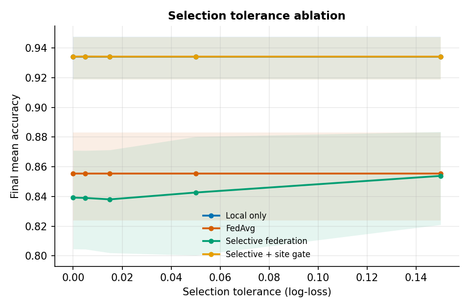
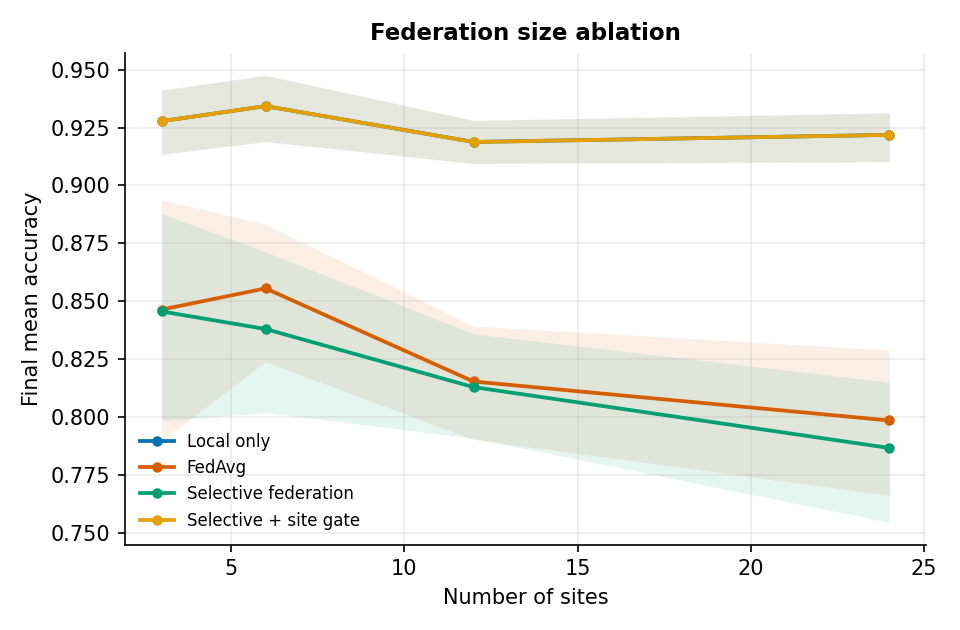
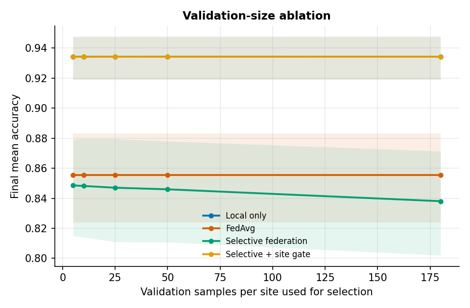
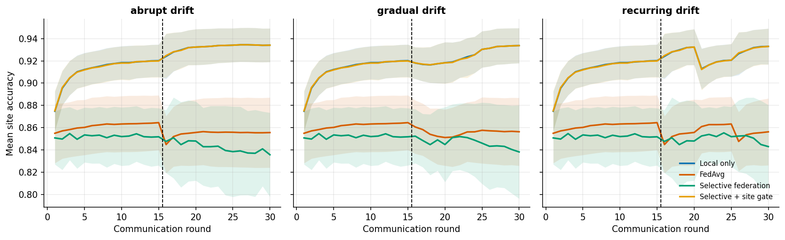

# Results (v0.4)

All numbers come from two commands; raw outputs are committed in [`docs/results/`](results/) and figures in [`assets/results/`](../assets/results/). Method and metric definitions are in [`METHODOLOGY.md`](METHODOLOGY.md).

```bash
python -m when_not_to_learn.benchmark --seeds 20 --sweep-seeds 10 --out results/benchmark   # ~25 min
python -m when_not_to_learn.realdata  --seeds 20 --out results/realdata                      # ~3 min
```

**Scope.** Sections 1–6 are synthetic (logistic regression, 6 features). Section 7 uses two public scikit-learn datasets with synthetic *partitions*. Nothing here is evidence about production federations.

## 1. Main comparison — 6 sites, ⅓ drift abruptly at round 15, 20 seeds


*Local only is hidden beneath "Selective + site gate" because the gate almost always selects the local model.*

| Method | Final mean acc. | 95 % CI | Final worst-site acc. | Drop at drift (pp) |
|---|---|---|---|---|
| Local only | 0.929 | 0.919–0.938 | 0.876 | 0.2 |
| Selective + site gate | 0.929 | 0.919–0.938 | 0.875 | 0.2 |
| Ditto | 0.914 | 0.903–0.924 | 0.861 | 0.3 |
| FedAvg + fine-tune | 0.886 | 0.870–0.901 | 0.798 | 0.4 |
| FedAvg | 0.843 | 0.822–0.863 | 0.675 | 3.5 |
| FedProx | 0.843 | 0.822–0.863 | 0.678 | 3.7 |
| Trimmed mean | 0.839 | 0.819–0.858 | 0.645 | 3.7 |
| Coordinate median | 0.834 | 0.815–0.852 | 0.616 | 3.9 |
| Selective federation | 0.825 | 0.800–0.849 | 0.704 | 2.8 |

Shared global models (FedAvg, FedProx, median, trimmed mean, selective) lose 3–4 pp mean accuracy at the drift and up to ~19 pp worst-site accuracy; methods with a personalised component barely notice it. FedProx with μ = 0.1 is statistically indistinguishable from FedAvg here (the proximal term is weak relative to the heterogeneity). The site gate chose the federated model in only **3.5 %** of (site, round) decisions.

## 2. Paired comparisons (same seeds, 95 % bootstrap CI)


| A vs B | Δ final accuracy | Δ final worst-site accuracy |
|---|---|---|
| Selective vs FedAvg | **−1.8 pp** (−2.6, −0.9) | +2.9 pp (−0.4, +7.0) |
| Selective vs FedProx | **−1.8 pp** (−2.7, −1.0) | +2.6 pp (−0.6, +6.6) |
| Selective vs median | −0.9 pp (−2.0, +0.2) | **+8.8 pp** (+4.1, +14.1) |
| Selective vs trimmed mean | **−1.4 pp** (−2.5, −0.3) | **+5.9 pp** (+1.2, +11.2) |
| Selective vs local-only | **−10.4 pp** (−12.5, −8.5) | **−17.1 pp** (−20.8, −13.8) |
| Site gate vs selective | **+10.4 pp** (+8.6, +12.5) | **+17.1 pp** (+13.8, +20.8) |
| Site gate vs local-only | 0.0 pp | 0.0 pp |
| FedAvg + fine-tune vs FedAvg | **+4.3 pp** (+3.1, +5.8) | **+12.3 pp** (+6.9, +19.4) |
| Ditto vs FedAvg | **+7.1 pp** (+5.7, +8.7) | **+18.6 pp** (+12.8, +26.1) |
| Ditto vs local-only | **−1.5 pp** (−1.9, −1.2) | **−1.5 pp** (−2.4, −0.6) |

Bold = interval excludes zero. P-values and win rates are in `docs/results/summary.json`; they are exploratory and not multiplicity-corrected.

## 3. Drift severity (20 seeds per setting)


Final **worst-site** accuracy (%), shared models:

| Severity | FedAvg | Median | Selective | Selective − FedAvg |
|---|---|---|---|---|
| 0 | 79.9 | 77.4 | 78.5 | −1.4 pp |
| 1 | 72.4 | 69.3 | 71.7 | −0.7 pp |
| 2 | 63.1 | 55.9 | 69.4 | **+6.3 pp** |
| 3 | 56.0 | 46.4 | 68.0 | **+12.0 pp** |
| 4 | 50.9 | 40.8 | 62.6 | **+11.7 pp** |

An earlier 8-seed version of this sweep looked non-monotonic; with 20 seeds the pattern is clean. **The guardrail costs a little when there is no drift and increasingly protects the worst-served site as drift becomes severe** — and at severity ≥ 3 mean accuracy is also on par with or above FedAvg (82.7 vs 82.6 at severity 3; 82.6 vs 81.6 at 4). This is the clearest regime in which selection earns its keep, although local training (87.7 worst-site) still dominates.

## 4. Ablations (10 seeds each)

| Ablation | Setting | Selective mean / worst-site (%) | FedAvg mean / worst-site (%) |
|---|---|---|---|
| **Tolerance** | 0.0 | 83.9 / 72.4 | 85.6 / 71.9 |
| | 0.015 (default) | 83.8 / 72.5 | 85.6 / 71.9 |
| | 0.05 | 84.3 / 72.7 | 85.6 / 71.9 |
| | 0.15 | 85.4 / 71.9 | 85.6 / 71.9 |
| **Number of sites** | 3 | 84.6 / 75.7 | 84.6 / 76.3 |
| | 6 | 83.8 / 72.5 | 85.6 / 71.9 |
| | 12 | 81.3 / **67.2** | 81.5 / 53.4 |
| | 24 | 78.7 / **49.6** | 79.9 / 40.6 |
| **Validation samples used** | 5 | 84.9 / 71.4 | 85.6 / 71.9 |
| | 25 | 84.7 / 72.2 | |
| | 180 (all) | 83.8 / 72.5 | |

  

* **Tolerance** barely matters until it is large enough to accept everything (0.15), at which point selective collapses to FedAvg. The default was not hiding a better setting.
* **More sites make the guardrail more valuable.** With 12–24 sites the selective rule protects the worst site by +14 and +9 pp over FedAvg at a small cost in mean accuracy (≤ 1.2 pp).
* **Selection is not fragile to small validation sets.** Even 5 validation samples per site gave the same worst-site accuracy within noise; slightly noisy signals even raised mean accuracy a little (more updates accepted). This weakens the worry that the selection rule *needs* large oracle validation sets — though it still sees every site's data in this simulator.
* In all ablations, local-only (93.4 / 88.1 %) and the site gate stay on top.

## 5. Drift schedules (10 seeds)



| Schedule | Local only | FedAvg | Selective | Selective + gate |
|---|---|---|---|---|
| Abrupt | 93.4 | 85.6 | 83.8 | 93.4 |
| Gradual (10-round ramp) | 93.3 | 85.7 | 84.2 | 93.3 |
| Recurring (every 5 rounds) | 93.1 | 85.4 | 84.9 | 93.1 |

(final mean accuracy, %). Conclusions did not change with the drift schedule at this severity; harsher recurring drift is future work.

## 6. When should a site learn collaboratively?

Accuracy gain over local-only (percentage points) across client heterogeneity × local data size, 10 seeds per cell.


* Collaboration helps only when sites are nearly identical **and** local data is modest (≤ 400 samples; about +1 to +3 pp, only at heterogeneity 0.1).
* At moderate-to-high heterogeneity shared models lose to local training by as much as 14 pp.
* With drift, no shared model beat local training in any cell.
* The per-site gate stays between −1.5 and +2.5 pp of local-only in every cell.

## 7. Real data (two public datasets, synthetic partitions, 20 seeds)


Final mean test accuracy (%); no temporal drift. *Digits*: digit ≥ 5, label-skewed Dirichlet(α) partitions over 6 sites. *Cancer*: malignant vs benign, sites are contiguous blocks of a noisy first-principal-component ranking (strong covariate skew).

| Scenario | Local | FedAvg | FedProx | Ditto | Selective | Site gate | Gate used federation |
|---|---|---|---|---|---|---|---|
| Digits, α = 0.1 (strong skew) | **95.3** | 75.0 | 75.0 | 93.2 | 69.2 | 95.1 | 3.8 % |
| Digits, α = 0.5 | **90.6** | 83.0 | 82.9 | 90.4 | 79.6 | 90.1 | 13.3 % |
| Digits, α = 5 (near-IID) | 85.8 | 88.7 | 88.6 | **88.8** | 86.6 | 86.8 | 53.5 % |
| Cancer, covariate skew | **94.7** | 75.3 | 75.4 | 94.1 | 65.9 | 94.4 | 4.8 % |

Paired differences vs local-only (95 % CI): FedAvg **−20.3 pp** (−23.3, −17.2) at α = 0.1 but **+2.8 pp** (+2.1, +3.6) at α = 5; Ditto +3.0 pp (+2.4, +3.6) at α = 5 and −2.0 pp (−3.6, −0.1) at α = 0.1; selective vs FedAvg is **negative in all four scenarios** (−2.1 to −9.4 pp).

**The synthetic story replicates on real data.** Whether collaboration helps is decided by heterogeneity: with near-identical sites everyone benefits from pooling (and the gate learns to federate 53 % of the time), whereas under strong skew, local training or a personalised method (Ditto) is best and the gate correctly abstains ~96 % of the time. In the near-IID regime the site gate (86.8) is below plain FedAvg (88.7) because it only chooses between local and the *selective* global model, which is itself weaker than FedAvg — a design limitation, not a bug.

## 8. Interpretation

1. "Should this site learn from the federation?" has a **site- and data-dependent** answer; a cheap per-site validation check captures most of it on both synthetic and real data.
2. A global mean/worst-site guardrail is a weak proxy for that decision on average, but it **does protect the worst site under severe drift and in large federations** — its niche is robustness, not accuracy.
3. Personalised methods (fine-tuned FedAvg, Ditto) dominate global-model methods whenever heterogeneity is non-trivial; any new selection method should be compared against them, not only FedAvg.
4. FedProx (μ = 0.1) and trimmed-mean aggregation add nothing over FedAvg in this setup. This may reflect the untuned μ and the nature of the heterogeneity (distribution shift, not Byzantine updates) rather than a flaw in those methods.
5. The strong local baseline is partly a property of small linear models with ≥ 60 samples per site; richer models or scarcer data could reverse it.

## 9. Reproducing and extending

Runs are seeded and deterministic. Published v0.3 numbers for the original methods were re-verified bit-for-bit after the v0.4 refactor. To add a scenario, create a `DriftConfig`, call `run_seeds`, then use `aggregate` / `paired_table` from `benchmark.py`; to add a dataset, add a partition function to `realdata.py`.
