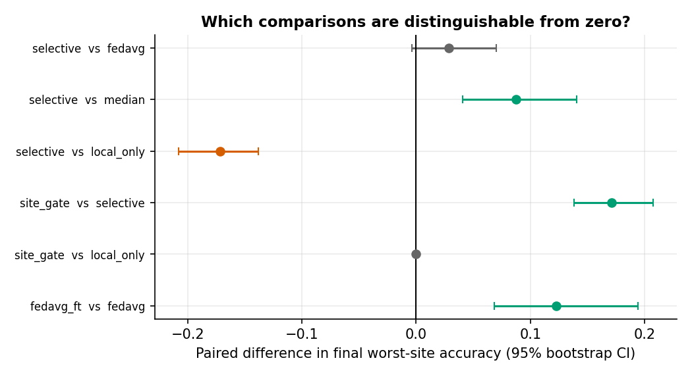
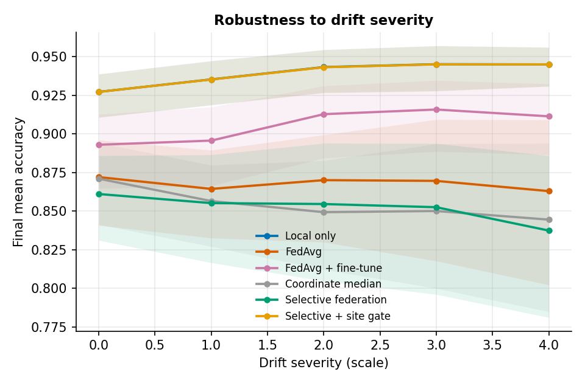

# Results (v0.3, synthetic)

All numbers come from `python -m when_not_to_learn.benchmark --seeds 20 --sweep-seeds 8 --out results/benchmark`; the raw outputs are committed in [`docs/results/`](results/) and the figures in [`assets/results/`](../assets/results/). Definitions of every method and metric are in [`METHODOLOGY.md`](METHODOLOGY.md). **These are synthetic, low-dimensional results. They are not evidence about real-world federations.**

## 1. Main comparison — 6 sites, ⅓ drift at round 15, 20 seeds


*Local only is drawn beneath "Selective + site gate" because the gate almost always selects the local model, so the two curves coincide.*

| Method | Final mean acc. | 95 % CI | Final worst-site acc. | Final log-loss | Drop at drift (pp) |
|---|---|---|---|---|---|
| Local only | 0.929 | 0.919–0.938 | 0.876 | 0.168 | 0.2 |
| Selective + site gate | 0.929 | 0.919–0.938 | 0.875 | 0.169 | 0.2 |
| FedAvg + fine-tune | 0.886 | 0.870–0.901 | 0.798 | 0.263 | 0.4 |
| FedAvg | 0.843 | 0.822–0.863 | 0.675 | 0.363 | 3.5 |
| Coordinate median | 0.834 | 0.815–0.852 | 0.616 | 0.436 | 3.9 |
| Selective federation | 0.825 | 0.800–0.849 | 0.704 | 0.405 | 2.8 |

Shared models (FedAvg, median, selective) lose roughly 3–4 pp of mean accuracy and up to about 19 pp of worst-site accuracy at the drift, because the drifted sites suddenly pull the global model away from everyone else. Models that can personalise barely notice the drift.

The site gate chose the federated model in only **3.5 %** of (site, round) decisions.

## 2. Paired comparisons (same seeds, 95 % bootstrap CI)



| A vs B | Δ final accuracy | Δ final worst-site accuracy |
|---|---|---|
| Selective vs FedAvg | **−1.8 pp** (−2.6, −0.9) | +2.9 pp (−0.4, +7.0) |
| Selective vs median | −0.9 pp (−2.0, +0.2) | **+8.8 pp** (+4.1, +14.1) |
| Selective vs local-only | **−10.4 pp** (−12.5, −8.5) | **−17.1 pp** (−20.8, −13.8) |
| Site gate vs selective | **+10.4 pp** (+8.6, +12.5) | **+17.1 pp** (+13.8, +20.8) |
| Site gate vs local-only | 0.0 pp | 0.0 pp |
| FedAvg + fine-tune vs FedAvg | **+4.3 pp** (+3.1, +5.8) | **+12.3 pp** (+6.9, +19.4) |

Bold = interval excludes zero. The permutation p-values and win rates are in `docs/results/summary.json`; they are exploratory and not corrected for multiple comparisons.

## 3. When should a site learn collaboratively?

Accuracy gain over local-only training, in percentage points, across client heterogeneity (columns) and training samples per site (rows). 8 seeds per cell.

**Stationary data (no drift)**


**A third of sites drift mid-training**


* Collaboration helps only when sites are nearly identical *and* local data is scarce (up to about +2 to +3 pp at heterogeneity 0.1 with 60–150 samples).
* As soon as heterogeneity is moderate-to-high, shared models lose to local training, by as much as 14 pp.
* With drift, no shared model beat local training in any cell of the grid.
* The per-site gate stays within about ±2 pp of local-only everywhere: it avoids the large losses but, in this simulator, also finds little to gain. The one visible cost is at the smallest sample size with high heterogeneity, where noisy validation sets (12 validation samples per site at n = 60) lead to some wrong choices (−1.7 pp, stationary).

## 4. Drift severity sweep (default heterogeneity, 8 seeds)



Mean final worst-site accuracy for shared models:

| Severity | FedAvg | Median | Selective | Selective − FedAvg |
|---|---|---|---|---|
| 0 | 0.804 | 0.787 | 0.782 | −2.2 pp |
| 1 | 0.746 | 0.713 | 0.731 | −1.5 pp |
| 2 | 0.722 | 0.627 | 0.748 | +2.6 pp |
| 3 | 0.691 | 0.588 | 0.717 | +2.6 pp |
| 4 | 0.654 | 0.577 | 0.629 | −2.5 pp |

The selection rule's guardrails help at intermediate drift severity and not at the extremes — a non-monotonic pattern that is worth investigating before drawing conclusions. With 8 seeds, none of these differences should be considered established.

## 5. Interpretation

1. The question "should this site learn from the federation?" has a **site-specific, data-dependent** answer, and a cheap per-site validation check captures most of it.
2. A global guardrail on mean and worst-site loss is a weak proxy for that per-site decision: it protects the *worst* site somewhat but reduces mean accuracy and never reaches local-only performance when local training is strong.
3. Personalisation (fine-tuning) recovers most of the gap between FedAvg and local-only training at almost no cost — any proposed selection method should beat it to be interesting.
4. The strong local-only baseline is partly an artefact of the simulator (a 7-parameter model with ≥ 60 training samples per site). Real federations with scarcer data, richer models, or label-scarce sites could reverse this.

## 6. Reproducing and extending

```bash
python -m when_not_to_learn.benchmark --seeds 20 --sweep-seeds 8 --out results/benchmark
```

Runs are seeded and deterministic: re-running yields identical aggregate statistics (verified when this document was produced). To add a scenario, create a `DriftConfig`, call `run_seeds`, and pass the result to `aggregate` / `paired_table` in `benchmark.py`.
